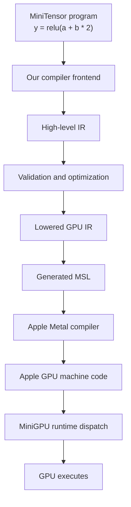
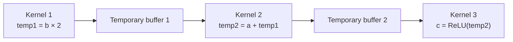
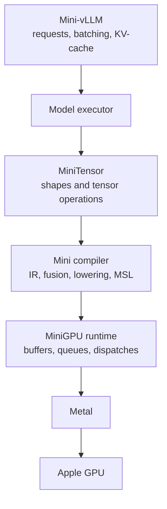

# Compiler learning guide

## Status

This file preserves the detailed compiler theory and the questions answered
before implementing Lesson 20.

The hands-on Lesson 20 implementation is documented separately in
[README.md](./README.md).

## Central idea

A compiler is a:

```text
checker
translator
optimizer
execution planner
```

For our project, it will convert tensor operations into Metal GPU kernels
automatically.

## Where the compiler fits



There are several compilers involved.

### Clang

Clang compiles our C++ and Objective-C++ application:

```text
our C++ compiler implementation
        ↓ Clang
ordinary CPU program
```

Our compiler itself is therefore an ordinary C++ program running on the CPU.

### Our mini compiler

At runtime, it translates:

```text
tensor operations → IR → generated MSL
```

### Apple's Metal compiler

It translates:

```text
MSL → real Apple GPU machine instructions
```

We are not initially replacing Apple's final compiler.

Our responsibility ends approximately here:

```text
Tensor operations → optimized MSL
```

Apple handles difficult hardware-specific work such as machine instructions
and register allocation.

## Do we actually need our compiler?

Strictly speaking, no.

We could manually write every kernel:

```metal
kernel void add(...);
kernel void multiply(...);
kernel void relu(...);
kernel void softmax(...);
kernel void rmsnorm(...);
```

That works for a few operations.

But imagine supporting:

```text
add f32
add f16
add broadcasting
multiply f32
multiply f16
add + ReLU
multiply + add
multiply + add + ReLU
different tensor shapes
different layouts
different GPUs
```

The number of handwritten combinations quickly becomes unmanageable.

A compiler lets the user describe **what they want**:

```cpp
Tensor y = relu(a + b * 2.0f);
```

Then it automatically determines **how to execute it**.

## A concrete running example

Suppose:

```text
a = [-3,  1,  5, -2]
b = [ 1,  2, -4, 10]
```

We request:

```cpp
Tensor c = relu(a + b * 2.0f);
```

`relu(x)` means:

```text
if x < 0 → produce 0
otherwise → produce x
```

The result is:

```text
b × 2       = [ 2, 4, -8, 20]
a + b × 2   = [-1, 5, -3, 18]
relu(...)   = [ 0, 5,  0, 18]
```

### Without fusion

A simple eager framework might launch three kernels:



That requires:

```text
3 GPU dispatches
2 temporary buffers
multiple GPU-memory reads
multiple GPU-memory writes
```

### With compiler fusion

Our compiler can generate one kernel:

```metal
output[index] =
    max(a[index] + b[index] * 2.0f, 0.0f);
```

Now we need:

```text
1 dispatch
0 intermediate tensor buffers
read a once
read b once
write c once
```

Fusion is one of the biggest reasons inference frameworks use compilers.

## Eager execution versus graph capture

### Eager execution

Each operation executes immediately:

```cpp
Tensor temp1 = b * 2;       // launch kernel
Tensor temp2 = a + temp1;   // launch kernel
Tensor c = relu(temp2);     // launch kernel
```

By the time `relu()` runs, the earlier kernels are already submitted. It is
too late to fuse them easily.

### Graph capture

Instead of executing immediately, the operations record a graph:

```text
a ──────────────────┐
                    Add → ReLU → c
b → Multiply by 2 ──┘
```

The compiler sees the whole calculation before executing it.

That lets it:

```text
validate shapes
infer result types
remove unnecessary work
fuse operations
plan temporary memory
generate one kernel
```

MiniTensor will eventually act as the frontend that creates this graph.

## What is a frontend?

The frontend accepts the user-facing description and converts it into the
compiler's internal format.

Eventually:

```cpp
Tensor c = relu(a + b * 2.0f);
```

could build the graph automatically using overloaded C++ operators.

Lesson 20 uses this explicit builder:

```cpp
Value a = builder.input("a");
Value b = builder.input("b");

Value two = builder.constant_f32(2.0f);
Value scaled = builder.multiply(b, two);
Value added = builder.add(a, scaled);
Value result = builder.relu(added);

builder.return_value(result);
```

This avoids building a complete programming-language parser.

## What is an AST?

AST means **Abstract Syntax Tree**.

It usually mirrors the syntax written by the programmer.

For:

```text
relu(a + b * 2)
```

the AST resembles:

```text
ReLU
└── Add
    ├── a
    └── Multiply
        ├── b
        └── 2
```

ASTs are useful when parsing a textual language.

Our first compiler does not really need a parser or traditional AST. C++
operator calls can construct our operation graph directly.

An AST is close to user syntax. An IR is designed more specifically for
compiler analysis and transformation.

## What is IR?

IR means **Intermediate Representation**.

It is the compiler's private, structured language between:

```text
user expression
```

and:

```text
generated MSL
```

A future typed version of our IR might print:

```text
%0 = input @a                    : tensor<4xf32>
%1 = input @b                    : tensor<4xf32>
%2 = constant 2.0                : f32
%3 = multiply %1, %2             : tensor<4xf32>
%4 = add %0, %3                  : tensor<4xf32>
%5 = relu %4                     : tensor<4xf32>
return %5
```

Lesson 20 deliberately omits the `tensor<4xf32>` type annotations. Types
and shapes belong to the next lesson.

This text is only a human-readable printout.

Internally, IR is made from ordinary C++ objects. A future typed operation
might look like:

```cpp
enum class Opcode {
    Input,
    Constant,
    Add,
    Multiply,
    Relu,
    Return,
};

struct Operation {
    Opcode opcode;
    std::vector<ValueId> inputs;
    Type result_type;
};
```

The smaller Lesson 20 `Operation` has no `Type` field yet. It stores an
opcode, an optional result ID, operand IDs and the small attributes needed
by inputs and constants.

### Operation versus value

An operation performs something:

```text
multiply
add
relu
```

A value refers to the result produced by an operation:

```text
%3 = multiply %1, %2
```

Here:

```text
multiply = operation
%3       = value produced by that operation
```

`%3` does not hold all the real tensor numbers during compilation.

It is a compiler handle saying:

> This value will be produced by the multiply operation when the program
> executes.

The actual tensor data enters through buffers at runtime.

## Why not generate MSL strings directly?

We technically could write:

```cpp
source += "output[id] = ";
source += expression;
```

But raw strings make it difficult to answer:

```text
Does this value exist?
Who produced it?
What dtype does it have?
What shape does it have?
Is this operation legal?
Is this operation unused?
Can two operations be fused?
Can we target something other than Metal?
```

IR gives the compiler something structured that it can inspect and modify
safely.

Think of IR as an architectural blueprint.

MSL is closer to the final construction instructions.

## What is SSA?

SSA means **Static Single Assignment**.

It means every compiler temporary is defined exactly once:

```text
%0 = load a[index]
%1 = load b[index]
%2 = multiply %1, 2.0
%3 = add %0, %2
%4 = maximum %3, 0.0
store output[index], %4
```

We never overwrite `%2` or `%3`.

Source code might reuse a name:

```cpp
x = a + b;
x = x * 2;
```

SSA creates versions:

```text
%x0 = add a, b
%x1 = multiply %x0, 2
```

This makes dependencies easy to understand:

```text
Who created %x1?
Which operations use %x0?
Is a value unused?
Is the same expression calculated twice?
```

Our first compiler needs only an SSA-like straight-line value graph. We do
not initially need complicated branches or loops in SSA form.

## Types, dtypes, shapes, strides and layouts

The compiler must know more than "this is a tensor."

### Dtype

How each element is represented:

```text
f32
f16
int8
int4
```

Example:

```text
f32 + f32 → valid
f32 + int8 → requires a defined conversion
```

### Shape

The logical dimensions:

```text
[4]
[2, 3]
[batch, heads, sequence, head_dimension]
```

Example:

```text
f32[1024] + f32[1024] → valid

f32[1024] + f32[512] → invalid
unless broadcasting rules allow it
```

For matrix multiplication:

```text
A[M, K] × B[K, N] → C[M, N]
```

The two `K` dimensions must match.

### Strides

Strides describe how logical indexes map to physical memory.

For a contiguous `[2, 3]` tensor:

```text
logical [row, column]
        ↓
memory offset = row × 3 + column
```

A transposed view might have the same values and shape but different
strides.

### Layout

Layout is the larger description of how values are arranged and packed.

It matters for:

```text
neighboring GPU accesses
vector loads
cache behavior
transposes
quantized weight packing
KV-cache pages
```

The compiler uses all this metadata to generate correct buffer addresses.

## Validation

In the fuller compiler we will build across later lessons, validation will
eventually check things such as:

```text
Every operand exists
Values are used only after being defined
Add receives two operands
Operand dtypes are compatible
Tensor shapes are compatible
Return value exists
Buffer indexes are valid
Operations have valid attributes
```

Lesson 20 implements only the structural subset: operands, definitions,
arity, result IDs, input names, attributes and the final return. It does not
yet know about dtypes, tensor shapes or buffer indexes.

For example:

```text
%0 = input : tensor<1024xf32>
%1 = input : tensor<512xf32>
%2 = add %0, %1
```

The verifier should report:

```text
Add requires matching shapes:
left  = [1024]
right = [512]
```

This is much better than producing invalid MSL or incorrect GPU memory
access.

Compiler correctness is extremely important: a compiler bug may produce
plausible but wrong model output.

## What is a compiler pass?

A pass performs one focused analysis or transformation.

```text
IR
 ↓ verification pass
IR
 ↓ shape-inference pass
IR
 ↓ constant-folding pass
IR
 ↓ dead-code-removal pass
IR
 ↓ fusion pass
optimized IR
```

Some passes inspect the program.

Other passes change it.

### Constant folding

Calculate constants during compilation:

```text
%0 = constant 3
%1 = constant 4
%2 = multiply %0, %1
```

becomes:

```text
%2 = constant 12
```

### Algebraic simplification

```text
x + 0 → x
x * 1 → x
```

Floating-point transformations need care because changing operation order
can change rounding.

### Dead-code elimination

```text
%0 = add a, b
%1 = multiply c, d
return %0
```

`%1` is never used, so it can be removed.

### Common-subexpression elimination

```text
%0 = add a, b
%1 = add a, b
```

The compiler might calculate the expression once and reuse `%0`.

### Fusion

```text
multiply → add → ReLU
```

becomes one GPU kernel.

Fusion can eliminate temporary buffers and dispatches.

But blindly fusing everything is not always good. A huge fused kernel might
use too many registers or reduce parallelism.

Our initial fusion rules will deliberately remain simple.

## What does lowering mean?

Lowering means replacing a high-level operation with more explicit
lower-level operations.

"Lower" means closer to hardware, not worse.

High-level IR:

```text
%result = tensor.add %a, %b
```

Lowered loop IR:

```text
parallel_for index from 0 to element_count:
    a_value = load a[index]
    b_value = load b[index]
    result = add a_value, b_value
    store output[index], result
```

GPU-mapped IR:

```text
index = global_thread_id

if index < element_count:
    output[index] = a[index] + b[index]
```

Generated MSL:

```metal
kernel void add(
    device const float* a [[buffer(0)]],
    device const float* b [[buffer(1)]],
    device float* output [[buffer(2)]],
    constant uint& count [[buffer(3)]],
    uint index [[thread_position_in_grid]]
) {
    if (index < count) {
        output[index] = a[index] + b[index];
    }
}
```

Each lowering stage makes previously implicit decisions explicit.

## Why have multiple IR levels?

Different levels answer different questions.

| Representation | Main question |
|---|---|
| Expression graph | What did the user request? |
| Tensor IR | Are types and shapes valid? Which operations can fuse? |
| Loop IR | Which tensor elements are loaded and stored? |
| GPU IR | Which lanes and groups perform the loops? |
| MSL | How is the work expressed for Metal? |
| Machine code | Which Apple GPU instructions execute? |

Consider softmax.

High-level IR:

```text
%result = softmax %input
```

Lowered mathematical operations:

```text
maximum reduction
subtract maximum
exponential
sum reduction
normalization
```

Lowered GPU operations:

```text
lane-strided loops
threadgroup scratch
max reduction tree
barriers
sum reduction tree
output writes
```

Generated target code:

```metal
threadgroup float maximum_scratch[256];
threadgroup_barrier(...);
```

Lesson 19 taught us how to implement the low-level form manually.

The compiler will eventually generate it from the high-level `softmax`
operation.

## Do we need to implement every IR level?

No.

The earlier list describes a possible production-style compiler:

```text
Very high-level IR:
    Softmax(input)

Tensor IR:
    maximum reduction
    exponentiation
    sum reduction
    normalization

GPU IR:
    lanes
    loads
    stores
    barriers

Low-level IR:
    assembly-like instructions

Machine code:
    actual hardware instructions
```

These are different representations of the same computation at different
abstraction levels.

The highest form describes **what** is required:

```text
Softmax(input)
```

The lower forms progressively describe **how** to perform it:

```text
reductions and exponentiation
        ↓
GPU lanes, memory and barriers
        ↓
target-language code such as MSL source
```

Different compilers use different numbers and kinds of IR. A compiler should
add another IR only when that representation makes a real problem easier.

### How one IR becomes another

A lowering pass can read one representation and create a more concrete
representation:

```cpp
TensorProgram tensor_program =
    build_tensor_ir();

KernelProgram kernel_program =
    lower_to_kernel_ir(tensor_program);

std::string msl =
    generate_msl(kernel_program);
```

For example:

```text
Input:
    Softmax(input)

lower_softmax():

Output:
    ReduceMax(input)
    Subtract(input, maximum)
    Exp(shifted)
    ReduceSum(weights)
    Divide(weights, sum)
```

Another lowering stage could replace `ReduceMax` with lane-local work,
threadgroup scratch, a reduction tree and barriers.

### In-place rewriting versus a new representation

Both approaches are useful.

Same-level optimizations often rewrite an existing IR:

```text
Before:
    %0 = multiply %x, 1
    return %0

After:
    return %x
```

Moving between substantially different abstraction levels often creates a
new program object:

```text
Tensor IR
    ↓ lowering
Kernel IR
```

This separation is useful because the two representations contain different
information:

```text
Tensor IR:
    shapes, dtypes and tensor operations

Kernel IR:
    loops, loads, stores, lanes and barriers
```

Larger compiler systems may temporarily mix several abstraction levels while
progressively replacing high-level operations. Our miniature compiler does
not initially need that complexity.

### IR normally lives in memory, not separate temporary files

The compiler normally stores IR as C++ objects:

```cpp
Program high_level_ir;
KernelProgram lowered_ir;
std::string generated_msl;
```

We can print each stage for debugging:

```text
--- IR before optimization ---

--- IR after optimization ---

--- Generated MSL ---
```

But these printouts do not need to become files. They are views of in-memory
program objects.

The compiler implementation may eventually be organized into source files
such as:

```text
ir.hpp / ir.cpp
passes.cpp
lowering.cpp
msl_codegen.cpp
```

That is codebase organization, not one temporary disk file for every IR
stage.

### The IR scope for Lesson 20

Lesson 20 implements only one small, high-level, SSA-like IR:

```text
Input
ConstantF32
Multiply
Add
ReLU
Return
```

The first path is:

```text
explicit C++ builder
        ↓
one in-memory IR
        ↓
structural verification
        ↓
deterministic printer
        ↓
small CPU semantic check
```

Lesson 20 does not implement:

```text
Tensor IR plus a separate Kernel IR
loop or GPU IR
assembly-like IR
MSL generation
Apple GPU machine code
MiniTensor operator syntax
```

The next lessons will add these capabilities only when needed. Our likely
later miniature pipeline is:

```text
MiniTensor expression graph
        ↓
Tensor IR
        ↓
Kernel IR
        ↓
MSL
        ↓ Apple's compiler
machine code
```

Apple's compiler remains responsible for its own low-level representations,
register allocation and Apple GPU machine-code generation.

## What is scheduling?

The algorithm says **what** result to calculate.

The schedule says **how** the GPU calculates it.

For elementwise addition:

```text
one lane per element
```

or:

```text
each lane handles several strided elements
```

For reduction:

```text
64, 128 or 256 threads per group?
How many values per lane?
Which reduction tree?
How many dispatches?
```

For matrix multiplication:

```text
tile sizes
which loops map to threadgroups
which loops map to lanes
what stays in registers
what uses threadgroup memory
loop unrolling
```

Two schedules can calculate the same result while having very different
performance.

Important distinction:

```text
Compiler scheduling:
    how GPU lanes execute one operation

Inference scheduling:
    which user requests and tokens enter the next batch
```

The future Mini-vLLM scheduler is not the same thing as a compiler schedule.

## Code generation and the backend

The backend handles target-specific details.

Our Metal backend will generate things such as:

```metal
device const float* input [[buffer(0)]]
uint index [[thread_position_in_grid]]
threadgroup float scratch[256]
threadgroup_barrier(...)
```

It must also produce metadata for the runtime:

```text
kernel name
buffer-binding order
scalar-binding order
launch configuration
required threadgroup memory
```

A later NVIDIA backend could translate the same high-level IR differently.

```text
Shared tensor IR
      ├── Metal backend → MSL
      └── NVIDIA backend → CUDA-related target code
```

The high-level meaning can be portable.

The best-performing schedule usually remains hardware-specific.

## Generated MSL for the running example

After fusion and lowering, our compiler could emit:

```metal
#include <metal_stdlib>
using namespace metal;

kernel void fused_relu_add_mul(
    device const float* a [[buffer(0)]],
    device const float* b [[buffer(1)]],
    device float* output [[buffer(2)]],
    constant uint& element_count [[buffer(3)]],
    uint global_id [[thread_position_in_grid]]
) {
    if (global_id >= element_count) {
        return;
    }

    const float multiplied =
        b[global_id] * 2.0f;

    const float added =
        a[global_id] + multiplied;

    output[global_id] =
        max(added, 0.0f);
}
```

Our existing MiniGPU layer then performs:

```cpp
Kernel kernel =
    device.compile_kernel(
        "fused_relu_add_mul",
        generated_msl
    );

Dispatch dispatch(kernel);

dispatch
    .bind_buffer(0, a_buffer)
    .bind_buffer(1, b_buffer)
    .bind_buffer(2, output_buffer)
    .bind_u32(3, element_count);

Event done = queue->submit(
    std::move(dispatch),
    LaunchConfig::cover(element_count, 256)
);

done.wait();
```

The compiler creates the kernel.

The runtime executes it.

## Compiler versus runtime

| Compiler responsibility | Runtime responsibility |
|---|---|
| Understand operations | Allocate actual buffers |
| Validate types and shapes | Bind buffers and scalars |
| Optimize the program | Create command buffers |
| Fuse operations | Submit GPU dispatches |
| Choose kernel schedule | Track events |
| Generate MSL | Synchronize CPU and GPU |
| Cache compiled variants | Report execution failures |

The compiler does not itself calculate the tensor result.

It creates a program that will calculate the result when the runtime executes
it.

## Compiler versus MiniTensor versus Mini-vLLM



### MiniTensor

Provides user-facing tensor operations:

```cpp
Tensor y = rmsnorm(x);
Tensor q = matmul(y, q_weights);
Tensor probabilities = softmax(scores);
```

### Compiler

Turns those operations into efficient kernels.

### MiniGPU

Executes the kernels.

### Mini-vLLM

Manages:

```text
requests
continuous batching
prefill versus decode
KV-cache pages
token positions
sampling
```

It selects and invokes compiled operations.

## JIT versus AOT

### AOT: ahead-of-time compilation

Compile before the program runs:

```text
build application
    ↓
compile every known kernel
    ↓
later execute
```

Advantages:

```text
low runtime startup cost
errors discovered earlier
predictable deployment
```

### JIT: just-in-time compilation

Compile when exact runtime information becomes available:

```text
first call:
operation + shape + dtype + device
        ↓
generate specialized MSL
        ↓
compile pipeline
        ↓
cache it
```

Later calls:

```text
same operation and configuration
        ↓
cache hit
        ↓
dispatch immediately
```

Our initial compiler will be JIT-like because it generates MSL and calls
`Device::compile_kernel()` while the application runs.

We must not compile again for every generated token.

## Kernel cache

Compilation has a cost.

Therefore:

```text
compile once
execute many times
```

A cache key might include:

```text
operation graph
dtype
shape or shape category
strides/layout
target device
compiler options
```

Example:

```text
fused add+relu
f32
4096 elements
contiguous
Apple M4 Pro
```

The first execution compiles it.

Later executions reuse the `Kernel`.

## Static versus dynamic shapes

### Static shape

Known during compilation:

```text
shape = [4096]
head dimension = 128
```

This permits:

```text
fixed loop counts
fewer runtime checks
possible loop unrolling
specialized group sizes
known scratch-memory size
```

### Dynamic shape

Known only when executing:

```text
element_count supplied through buffer(3)
```

This is more flexible but may prevent some optimizations.

Inference systems often use several specialized variants rather than one
kernel for every imaginable shape.

For example:

```text
prefill kernel
    many tokens

decode kernel
    one new token per active request
```

These workloads have different shapes and need different schedules.

## Autotuning

Sometimes we do not know which schedule is fastest.

The compiler can create candidates:

```text
64 threads per group
128 threads per group
256 threads per group
```

Then:

```text
warm up
verify correctness
measure repeatedly
compare median latency
cache the winner
```

That is autotuning.

It is not model training. It is experimentally selecting a kernel schedule.

Lesson 19's warm-up and median timing are the foundation for this.

## Memory planning

The compiler can analyze when intermediate values are needed.

Suppose:

```text
temp1 = add(a, b)
temp2 = multiply(temp1, c)
output = relu(temp2)
```

Without fusion, it asks:

```text
When does temp1 become unused?
Can its buffer be reused for temp2?
Should temporary storage be shared or private?
How many bytes are required?
```

With fusion, it might remove both buffers:

```text
load a, b and c
calculate in lane-private registers
write output once
```

This connects directly to Lesson 16.

## Quantization

Quantized inference introduces more compiler information:

```text
stored dtype: int8 or int4
scale dtype:  f16 or f32
accumulation: often wider
packing layout
group size
zero point
```

A naive implementation might:

```text
dequantize complete weights into floats
then run matrix multiplication
```

A better compiler can fuse them:

```text
load packed weight
unpack
apply scale
multiply by activation
accumulate
```

This avoids producing an enormous temporary floating-point weight matrix.

## KV cache and side effects

Compiler values are often mathematical and immutable.

KV cache is mutable state:

```text
decode step 1 writes position 0
decode step 2 reads position 0 and writes position 1
decode step 3 reads positions 0–1 and writes position 2
```

The IR must represent these side effects explicitly.

Otherwise, an optimizer might incorrectly decide:

```text
this write looks unused, remove it
```

Future operations might include:

```text
KVWrite
KVRead
PagedAttention
```

The compiler lowers their address calculations.

The Mini-vLLM runtime decides which cache pages belong to each request.

## Graph compiler, tensor compiler and kernel compiler

These are useful conceptual layers.

### Graph compiler

Sees model operations:

```text
RMSNorm → Linear → SiLU → Linear
```

Handles:

```text
operation dependencies
large-scale fusion
unused operations
shape propagation
temporary-memory planning
```

### Tensor compiler

Understands:

```text
shapes
strides
broadcasting
reductions
layouts
matrix multiplication
```

It converts tensor operations into loops and index calculations.

### Kernel compiler/backend

Maps loops onto:

```text
GPU lanes
threadgroups
registers
threadgroup memory
barriers
```

Then emits MSL.

The boundaries are not absolute. Our miniature compiler will gradually cover
parts of all three.

## How this applies to LLM inference

Compiler-generated operations will eventually include:

```text
embedding lookup
matrix multiplication
RMSNorm
RoPE
attention score calculation
masking
softmax
KV-cache reads and writes
MLP activations
quantized weight loading
sampling operations
```

Major optimization opportunities include:

```text
bias + activation fusion
RMSNorm fusion
Q/K/V transformations
scale + mask + softmax
dequantization + matrix multiplication
shape-specialized prefill and decode kernels
```

Dynamic batching remains mostly an inference-runtime problem, but the
compiler must generate kernels that accept dynamic batch metadata.

## Does this transfer to diffusion models?

Yes.

The same compiler foundations apply:

```text
IR
shape and dtype checking
strides and layouts
fusion
memory planning
quantization
kernel generation
scheduling
autotuning
```

LLMs emphasize:

```text
autoregressive decode
KV cache
ragged batches
attention
```

Diffusion models emphasize:

```text
repeated denoising steps
larger spatial tensors
convolutions or linear layers
attention
normalization and activation fusion
```

The compiler foundation is shared.

## What we will actually build

We are not going to begin with a massive general-purpose compiler.

Our miniature path is:

```text
Lesson 20:
    C++ IR objects
    SSA-like Value IDs
    input, constant_f32, multiply, add, ReLU and return
    structural verifier
    deterministic printer
    tiny CPU evaluator

Lesson 21:
    scalar and tensor types
    shapes
    type and shape inference
    basic broadcasting

Lesson 22:
    lowering for elementwise work
    MSL generation
    buffer and launch metadata
    MiniGPU execution

Lesson 23 and later:
    optimization passes and elementwise fusion
    compiled-kernel cache
    shapes, strides and richer broadcasting
    reductions and softmax lowering
    matmul and tiling
    quantized operations
```

The first multi-lesson compiler milestone will compile:

```cpp
relu(a + b * 2.0f)
```

into one real Metal kernel.

## What we are not initially building

We will not initially build:

```text
a C++ or Python parser
LLVM
an Apple GPU machine-code generator
register allocation
a linker
arbitrary control flow
training or automatic differentiation
every tensor operation
a production-grade optimizer
```

Apple's compiler continues handling MSL-to-machine-code translation.

## Mental model to keep

```text
Frontend
    captures what the user requested

IR
    gives the compiler a precise internal program

Verifier
    rejects invalid programs

Passes
    analyze and transform the IR

Lowering
    replaces abstract tensor operations with concrete loops and GPU work

Scheduling
    decides how lanes, groups and memory perform that work

Code generation
    emits MSL

Apple compiler
    converts MSL into GPU machine code

MiniGPU runtime
    binds buffers and executes the compiled kernel
```
