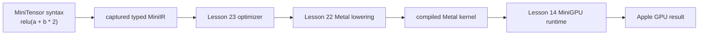

# Lesson 24 — MiniTensor expression capture and evaluation

## Outcome

Lesson 24 adds the first user-facing tensor frontend.

We can now write:

```cpp
minitensor::Graph graph;

minitensor::Tensor a = graph.input("a", {4});
minitensor::Tensor b = graph.input("b", {4});

minitensor::Tensor output =
    minitensor::relu(a + b * 2.0f);
```

instead of manually spelling every compiler operation:

```cpp
miniir::Value two = builder.constant_f32(2.0f);
miniir::Value scaled = builder.multiply(b, two);
miniir::Value added = builder.add(a, scaled);
miniir::Value output = builder.relu(added);
```

Both versions create the same typed MiniIR:

```text
%0 = input @a : tensor<4xf32>
%1 = input @b : tensor<4xf32>
%2 = constant_f32 2.0 : f32
%3 = multiply %1, %2 : tensor<4xf32>
%4 = add %0, %3 : tensor<4xf32>
%5 = relu %4 : tensor<4xf32>
return %5
```

The important result is not merely shorter syntax. We now have a proper
frontend boundary:



The normal build, strict warning build, real Metal execution, ASan/UBSan run,
and Clang static analysis pass.

## Lesson boundary

This lesson implements:

```text
symbolic Tensor handles
Graph ownership
operator + and operator *
float scalar lifting
relu(...)
expression capture
graph sealing
compiler integration
synchronous GPU evaluation
compile once, evaluate many times
```

It deliberately does not implement:

```text
strides
views
transposes
non-contiguous storage
matmul
softmax
model loading
KV cache
batching
Mini-vLLM scheduling
```

Those features build on this frontend rather than being mixed into its first
lesson.

## The complete user path

```cpp
const miniir::Type vector4 =
    miniir::Type::tensor(
        miniir::DType::F32,
        {4}
    );

minitensor::Graph graph;

const minitensor::Tensor a =
    graph.input("a", vector4);
const minitensor::Tensor b =
    graph.input("b", vector4);

const minitensor::Tensor output =
    minitensor::relu(a + b * 2.0f);

const minitensor::CapturedExpression captured =
    minitensor::capture(output);

minigpu::Device device;
auto queue = device.create_queue();

const minitensor::CompiledExpression compiled =
    minitensor::compile(device, captured);

const minitensor::TensorData result =
    minitensor::evaluate(
        device,
        *queue,
        compiled,
        {
            {
                "a",
                minitensor::TensorData(
                    vector4,
                    {-3.0f, 1.0f, 5.0f, -2.0f}
                ),
            },
            {
                "b",
                minitensor::TensorData(
                    vector4,
                    {1.0f, 2.0f, -4.0f, 10.0f}
                ),
            },
        }
    );
```

The result is:

```text
[0, 5, 0, 18]
```

There are three separate phases:

```text
1. build symbolic calculation
2. compile symbolic calculation
3. evaluate with concrete data
```

Keeping those phases separate is fundamental to inference engines.

## The five important objects

| Object | Contains | Does not contain |
|---|---|---|
| `Graph` | shared capture state and a `ProgramBuilder` | tensor numbers |
| `Tensor` | graph handle plus typed SSA `Value` | GPU storage |
| `CapturedExpression` | finished and verified `Program` | compiled machine code |
| `CompiledExpression` | optimized program and Metal executable | one fixed input batch |
| `TensorData` | concrete type and host `float` values | symbolic operations |

The most important distinction is:

```text
Tensor       = what value should be calculated
TensorData   = actual numbers supplied to one evaluation
```

## `Tensor` is symbolic

After:

```cpp
Tensor output = relu(a + b * 2.0f);
```

`output` does not contain:

```text
[0, 5, 0, 18]
```

It contains approximately:

```text
graph identity
SSA value ID %5
type tensor<4xf32>
```

No GPU buffer has been allocated yet.

No Metal source has been generated yet.

No kernel has been launched yet.

The operators record a future calculation.

This is deferred execution:

```text
describe now
execute later
```

## MiniTensor does not create a second IR

Lesson 24 is intentionally a thin frontend.

Internally, the graph owns the existing Lesson 21 builder:

```cpp
struct GraphState {
    miniir::ProgramBuilder builder;
    std::unordered_set<std::string> input_names;
    bool sealed = false;
};
```

Each MiniTensor operator immediately asks that builder to append one MiniIR
operation.

For example:

```cpp
Tensor operator*(
    const Tensor& left,
    const Tensor& right
) {
    return Tensor(
        left.state_,
        left.state_->builder.multiply(
            left.value_,
            right.value_
        )
    );
}
```

Therefore:

```cpp
Tensor scaled = b * two;
```

immediately records:

```text
%3 = multiply %1, %2
```

But it does not execute that multiplication.

The operation list is still the dependency graph:

```text
b ──┐
    Multiply ──┐
2 ──┘          │
               Add → ReLU → output
a ─────────────┘
```

We did not add an AST or another graph-node hierarchy because the existing
typed SSA program already stores exactly the dependencies this lesson needs.

### A small C++ ordering detail

Operator overloads record operations while C++ evaluates the expression.

The dependency order in:

```cpp
relu(a + b * 2.0f)
```

is unambiguous: `b * 2.0f` must exist before the outer Add, and the Add must
exist before ReLU.

For two independent branches:

```cpp
(a * 2.0f) + (b * 3.0f)
```

C++ does not promise which Multiply operand is evaluated first. Both programs
calculate the same result, but the two independent Multiply operations may
receive different SSA IDs.

When exact construction order matters for debugging, use named statements:

```cpp
Tensor left = a * 2.0f;
Tensor right = b * 3.0f;
Tensor output = left + right;
```

Production graph systems commonly canonicalize ordering later. Lesson 24
keeps the frontend mechanism visible and simple.

## What `b * 2.0f` does

The C++ compiler selects:

```cpp
Tensor operator*(
    const Tensor& left,
    float right
);
```

Our implementation first turns the ordinary float into a symbolic scalar:

```cpp
const Tensor scalar(
    left.state_,
    left.state_->builder.constant_f32(right)
);
```

Then it records tensor-times-scalar:

```cpp
return left * scalar;
```

So:

```cpp
b * 2.0f
```

means:

```text
%2 = constant_f32 2.0 : f32
%3 = multiply %1, %2 : tensor<4xf32>
```

The Lesson 21 type system performs scalar broadcasting.

We support all four scalar positions:

```cpp
x * 2.0f
2.0f * x
x + 1.0f
1.0f + x
```

There is still no general tensor broadcasting. Two non-scalar tensors must
have equal shapes.

Scalar overloads validate compatibility before appending the scalar
constant. Therefore a failed operation such as:

```cpp
Tensor x_f16 = graph.input(
    "x",
    {4},
    miniir::DType::F16
);

x_f16 + 1.0f; // no implicit f16/f32 cast
```

reports a dtype error without leaving a hidden dead f32 constant in the open
graph.

## Why every `Tensor` retains shared graph state

The central lifetime relationship is:

```text
Graph ─────┐
Tensor a ──┤
Tensor b ──┼── shared GraphState ── ProgramBuilder operations
Tensor y ──┘
```

The C++ representation is:

```cpp
std::shared_ptr<detail::GraphState> state_;
miniir::Value value_;
```

This gives us two useful properties.

First, all operands can prove that they belong to the same builder:

```cpp
if (left.state_ != right.state_) {
    throw FrontendError(
        "cannot combine Tensors from different "
        "MiniTensor graphs"
    );
}
```

Value ID `%0` from one graph is unrelated to value ID `%0` from another
graph. Comparing the graph state prevents accidental mixing.

Second, an output Tensor may outlive the public `Graph` variable:

```cpp
Tensor make_expression() {
    Graph graph;
    Tensor x = graph.input("x", {3});
    return relu(x + 1.0f);
}

Tensor output = make_expression();
CapturedExpression expression = capture(output);
```

The returned Tensor still holds shared ownership of `GraphState`, so its
builder and recorded operations remain alive.

`shared_ptr` handles lifetime only. It does not make graph mutation
thread-safe. Lesson 24 expects one thread to construct a graph.

## Copying a Tensor does not copy data or operations

Consider:

```cpp
Tensor scaled = x * 2.0f;
Tensor same_scaled = scaled;
Tensor output = scaled + same_scaled;
```

Copying `scaled` copies its symbolic handle:

```text
same graph
same SSA value ID
same type
```

The resulting IR is:

```text
%0 = input @x : tensor<4xf32>
%1 = constant_f32 2.0 : f32
%2 = multiply %0, %1 : tensor<4xf32>
%3 = add %2, %2 : tensor<4xf32>
return %3
```

There is only one multiply.

Both Add operands reuse `%2`.

This is a small example of a shared dependency in a DAG.

## Capture and graph sealing

Building operators leaves the graph open:

```text
inputs and operations may still be added
```

Calling:

```cpp
CapturedExpression captured = capture(output);
```

does three things:

```cpp
output.state_->builder.return_value(output.value_);
output.state_->sealed = true;
return CapturedExpression(
    output.state_->builder.build()
);
```

Step by step:

1. `return_value` declares the selected expression result.
2. `sealed = true` prevents later operators from changing the graph.
3. `build()` verifies and produces an immutable-style `Program` value.

After capture, these are rejected:

```cpp
output + 1.0f;
graph.scalar(1.0f);
capture(output);
```

Why seal it?

The compiled program should have a stable meaning. If operations could be
silently appended after finalization, it would become unclear which graph
version a compiled executable represents.

## Capture is not compilation

`capture(output)` produces:

```text
typed MiniIR
```

It does not produce:

```text
MSL
Metal library
GPU machine code
GPU buffers
results
```

This means expression construction and capture can be tested without creating
a GPU device.

## Compilation

Compilation reuses the lower layers rather than duplicating them:

```cpp
OptimizationResult optimization =
    optimize_elementwise(expression.program());

MetalKernelPlan plan =
    lower_to_metal(optimization.program);

MetalExecutable executable =
    compile_metal(device, plan);
```

The path is:

```text
CapturedExpression
        ↓
Lesson 23 constant folding and DCE
        ↓
Lesson 22 MSL generation and binding metadata
        ↓
Apple Metal compiler
        ↓
reusable MetalExecutable
```

Lesson 23's multi-program linear fusion function is not needed here.

The whole MiniTensor expression was captured as one `Program`, so its
elementwise Multiply, Add, and ReLU are already generated inside one Metal
kernel.

For:

```cpp
relu(a + b * 2.0f)
```

the generated per-lane core is approximately:

```metal
const float v0 = input_0[global_id];
const float v1 = input_1[global_id];
const float v2 = 2.0f;
const float v3 = v1 * v2;
const float v4 = v0 + v3;
const float v5 = max(v4, 0.0f);

output[global_id] = v5;
```

One lane calculates one output element.

## Why optimization remains useful

The frontend can record work that later becomes unnecessary:

```cpp
Tensor x = graph.input("x", {4});

static_cast<void>(x + 100.0f); // unused branch

Tensor one = graph.scalar(1.0f);
Tensor two = one + one;
Tensor output = x * two;
```

Captured IR contains the unused branch and scalar addition.

Lesson 23 then:

```text
folds 1 + 1 into 2
removes x + 100
removes constants that became dead
renumbers the surviving SSA values
```

The optimized program is:

```text
%0 = input @x : tensor<4xf32>
%1 = constant_f32 2.0 : f32
%2 = multiply %0, %1 : tensor<4xf32>
return %2
```

The frontend describes the calculation. Compiler passes clean and optimize
that description.

Optimization can also remove an unused declared input:

```cpp
Tensor x = graph.input("x", {4});
Tensor unused = graph.input("unused", {4});
Tensor output = x * 2.0f;
```

The compiled Metal plan requires only `x`.

Evaluation uses the following rule:

```text
live optimized input       must be supplied
dead captured input        may be omitted
dead captured input given  type-check it, then ignore it
never-declared input       reject it
```

This lets callers safely pass a feed dictionary built from the captured
frontend signature, while the optimizer is still free to remove runtime work.

## Evaluation

`evaluate(...)` supplies concrete data to a previously compiled expression:

```cpp
TensorData result = evaluate(
    device,
    queue,
    compiled,
    inputs
);
```

Its path is:

```text
validate named TensorData inputs
        ↓
allocate MiniGPU buffers
        ↓
copy host values into buffers
        ↓
bind buffers to the compiled kernel
        ↓
submit one dispatch
        ↓
wait for its Event
        ↓
read output buffer
        ↓
return TensorData
```

The implementation waits here:

```cpp
minigpu::Event finished = queue.submit(
    expression.executable_.make_dispatch(
        runtime_inputs,
        output
    ),
    expression.executable_.make_launch()
);

finished.wait();
```

Why is the wait required?

`evaluate` promises to return CPU-visible result values. Without waiting, the
CPU could read the output buffer before the GPU writes it.

This is the same asynchronous queue principle from the MiniGPU lessons, now
hidden behind a higher-level frontend operation.

## `TensorData` versus a future storage Tensor

`TensorData` contains:

```text
Type
std::vector<float>
```

For a multidimensional type such as `tensor<2x3xf32>`, the vector contains
six flattened contiguous values in row-major convention. Lesson 24 does not
yet store or interpret strides, offsets, alternative layouts, or
non-contiguous views.

It lets this lesson validate that:

```text
@a expects tensor<4xf32>
```

and reject:

```text
tensor<2x2xf32>
```

even though both contain four floats.

`TensorData` is deliberately not the final runtime tensor design.

During every call to `evaluate`, Lesson 24:

```text
allocates input buffers
uploads input values
allocates an output buffer
downloads output values
```

That is convenient for learning, but an inference engine cannot pay these
costs around every small operation.

Later lessons will introduce storage-bearing tensors and buffer reuse:

```text
shape
strides
offset
device buffer
views
contiguity
```

Then model operations can keep activations and weights on the GPU rather than
round-tripping through `std::vector<float>`.

## Compile once, evaluate many times

Compilation depends on:

```text
operations
types
static shapes
```

It does not depend on the actual values in `a` and `b`.

Therefore one compiled expression can be reused:

```cpp
CompiledExpression compiled =
    compile(device, captured);

TensorData first =
    evaluate(device, queue, compiled, first_inputs);

TensorData second =
    evaluate(device, queue, compiled, second_inputs);
```

The demo gets:

```text
first inputs  → [0, 5, 0, 18]
second inputs → [2, 0, 6, 0]
```

The kernel is compiled once.

Only the concrete input buffers change.

This is directly relevant to inference:

```text
compile model operation once
execute it for many requests and tokens
```

Future kernel caching will reuse compiled expressions automatically rather
than requiring the caller to retain them manually.

## Runtime scalar inputs

Scalar literals such as `2.0f` are compile-time constants.

The graph can also accept a runtime scalar:

```cpp
Tensor x = graph.input("x", {5});
Tensor scale = graph.scalar_input("scale");
Tensor bias = graph.scalar_input("bias");

Tensor output = relu(x * scale + bias);
```

At evaluation:

```text
x     → 5 floats
scale → 1 float
bias  → 1 float
```

Every GPU lane reads:

```metal
input_x[global_id]
input_scale[0]
input_bias[0]
```

The scalar values are broadcast across all output elements.

Remember:

```text
f32                 = rank-zero scalar
tensor<1xf32>       = rank-one tensor with one element
```

They have the same number of stored values but different types.

## Error boundaries

The frontend rejects errors as early as the relevant layer can understand
them.

### Frontend errors

```text
mixing Tensors from different graphs
adding operations after capture
capturing a graph twice
duplicate input names
```

### Type-system errors

```text
tensor shape mismatch
dtype mismatch
unsupported implicit casts
```

These still come from the Lesson 21 `ProgramBuilder`.

### Backend errors

The frontend can represent f16:

```cpp
Tensor x = graph.input(
    "x",
    {4},
    miniir::DType::F16
);
```

But the current Lesson 22 Metal backend only generates f32 kernels.

Therefore capture succeeds and Metal compilation reports:

```text
Lesson 22 Metal backend supports only f32
```

This distinction is useful:

```text
valid frontend program
does not necessarily mean
supported by every backend
```

### Evaluation errors

Before submitting GPU work, evaluation rejects:

```text
missing named input
unknown extra input
wrong shape
wrong dtype
wrong element count
```

The `Device`, `Queue`, and `CompiledExpression` passed to `evaluate` must
belong to the same Metal device. Our current MiniGPU opens the system default
device, so this is straightforward on the Mac used here. A future multi-device
runtime should store and validate device identity explicitly before staging
buffers.

## Important files

```text
minitensor.hpp
    public frontend, capture, compile and evaluate API

minitensor.cpp
    symbolic operator recording, ownership and runtime bridge

demo.mm
    focused correctness and real-Metal integration tests

README.md
    lesson explanation
```

The implementation reuses these files directly:

```text
Lesson 21 miniir.cpp
Lesson 22 metal_backend.cpp
Lesson 23 optimizer.cpp
Lesson 14 minigpu.mm
```

Do not compile Lesson 20's older `miniir.cpp` at the same time as Lesson 21.
They are educational snapshots of the same evolving library and define
overlapping symbols.

## What the demo verifies

The demo checks:

1. MiniTensor syntax creates exactly the explicit-builder IR.
2. `relu(a + b * 2)` infers `tensor<4xf32>`.
3. scalar literals work on the left and right of Add and Multiply.
4. shape and dtype mismatches remain rejected.
5. Tensors from different graphs cannot be combined.
6. duplicate input names are rejected.
7. copying a Tensor reuses one SSA value.
8. a Tensor safely retains graph state after the public Graph dies.
9. capture seals the graph.
10. constant folding and DCE compose with the frontend.
11. optimized-away input feeds may be supplied or omitted safely.
12. failed scalar type checks do not mutate the graph.
13. Metal metadata and padded-lane guard remain correct.
14. the real GPU produces `[0, 5, 0, 18]`.
15. the same compiled expression accepts a second input set.
16. runtime scalar broadcasting works.
17. host input type validation happens before dispatch.
18. the f16 frontend/backend capability boundary is reported.

## Build and run

From the workspace root:

```bash
xcrun clang++ \
  -std=c++20 \
  -O2 \
  -g \
  -Wall \
  -Wextra \
  -Wpedantic \
  -fobjc-arc \
  outputs/infer-lab/phase0/lesson21-types-shapes-broadcasting/miniir.cpp \
  outputs/infer-lab/phase0/lesson22-metal-codegen/metal_backend.cpp \
  outputs/infer-lab/phase0/lesson23-optimization-fusion/optimizer.cpp \
  outputs/infer-lab/phase0/lesson24-minitensor-frontend/minitensor.cpp \
  outputs/infer-lab/phase0/lesson14-metal-minigpu/minigpu.mm \
  outputs/infer-lab/phase0/lesson24-minitensor-frontend/demo.mm \
  -framework Foundation \
  -framework Metal \
  -o work/lesson24_minitensor_frontend

./work/lesson24_minitensor_frontend
```

A restricted sandbox may hide the Metal device. In that case the executable
must be allowed to access the Mac GPU.

## Sanitized build

```bash
xcrun clang++ \
  -std=c++20 \
  -O1 \
  -g \
  -Wall \
  -Wextra \
  -Wpedantic \
  -fobjc-arc \
  -fsanitize=address,undefined \
  -fno-omit-frame-pointer \
  outputs/infer-lab/phase0/lesson21-types-shapes-broadcasting/miniir.cpp \
  outputs/infer-lab/phase0/lesson22-metal-codegen/metal_backend.cpp \
  outputs/infer-lab/phase0/lesson23-optimization-fusion/optimizer.cpp \
  outputs/infer-lab/phase0/lesson24-minitensor-frontend/minitensor.cpp \
  outputs/infer-lab/phase0/lesson14-metal-minigpu/minigpu.mm \
  outputs/infer-lab/phase0/lesson24-minitensor-frontend/demo.mm \
  -framework Foundation \
  -framework Metal \
  -o work/lesson24_minitensor_frontend_sanitized

./work/lesson24_minitensor_frontend_sanitized
```

ASan and UBSan inspect the host C++ and Objective-C++ paths. They do not
instrument GPU memory accesses inside generated MSL.

## Expected key output

```text
Lesson 24: MiniTensor frontend

Captured MiniIR:
%0 = input @a : tensor<4xf32>
%1 = input @b : tensor<4xf32>
%2 = constant_f32 2.0 : f32
%3 = multiply %1, %2 : tensor<4xf32>
%4 = add %0, %3 : tensor<4xf32>
%5 = relu %4 : tensor<4xf32>
return %5

First GPU evaluation:  [0, 5, 0, 18]
Reused compiled graph:  [2, 0, 6, 0]
Runtime scalar inputs: [0, 0, 0, 1, 3]

PASS: MiniTensor syntax captured, compiled, and reused one real Metal kernel.
```

## Main takeaways

1. MiniTensor is the user-facing frontend above MiniIR.
2. Lesson 24's `Tensor` is symbolic; it is not a GPU buffer.
3. Operator overloads append typed MiniIR operations.
4. `b * 2.0f` lifts the float into a scalar SSA constant.
5. Existing MiniIR remains the only compiler IR in this lesson.
6. Every Tensor shares ownership of its graph state.
7. Graph identity prevents mixing unrelated SSA values.
8. Copying a Tensor reuses a symbolic value rather than duplicating work.
9. Capture selects a Return value, verifies the program, and seals the graph.
10. Compilation and evaluation are different phases.
11. Compilation reuses the optimizer and Metal backend.
12. Evaluation validates data, allocates buffers, dispatches, waits, and reads.
13. The Event wait is necessary before returning CPU-visible values.
14. One compiled expression can run with many concrete input sets.
15. Frontend support and backend support are separate capability questions.
16. Optimization may reduce the executable's live input signature.
17. Persistent device storage is the next important tensor-layer improvement.

## What to understand versus skim

Understand:

```text
Tensor versus TensorData
operators record instead of calculate
GraphState shared ownership
same-graph requirement
scalar lifting
same SSA value reuse
capture and sealing
CapturedExpression versus CompiledExpression
compile once, evaluate many
why evaluate waits
frontend capability versus backend capability
```

Skim:

```text
vector-printing helper
generic require_throws helper
individual negative-test setup
Objective-C autorelease pool
host upload/download loops
boilerplate includes
```

## What comes next

Lesson 24 gives us the expression frontend, but its runtime values still begin
and end as host vectors.

The next compact tensor block should add:

```text
Lesson 25 — storage, shape, strides, offset and contiguity
Lesson 26 — views, slicing and transpose
Lesson 27 — layout-aware GPU indexing
Lesson 28 — contiguous materialization and buffer reuse
```

After that, MiniTensor can keep real model weights and activations on the GPU,
which prepares us for:

```text
matmul and transformer operations
loading a small Hugging Face model
prefill and decode
KV cache
continuous batching
paged KV cache and Mini-vLLM
```
