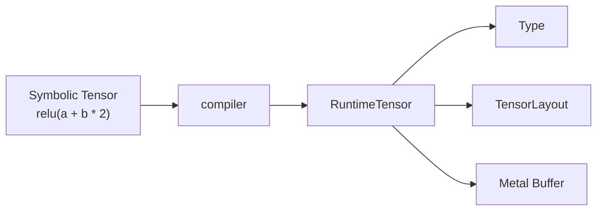

# Lesson 25 — How a tensor lives in memory

## The one idea

```text
RuntimeTensor = flat storage + metadata
```

The storage owns numbers:

```text
[10, 11, 12, 20, 21, 22]
```

The metadata tells us to interpret those numbers as:

```text
[
  [10, 11, 12],
  [20, 21, 22]
]
```

The metadata consists mainly of:

```text
shape
strides
offset
```

## What we built

```cpp
RuntimeTensor matrix =
    RuntimeTensor::from_host(
        device,
        Type::tensor(DType::F32, {2, 3}),
        {
            10, 11, 12,
            20, 21, 22,
        }
    );
```

This creates:

```text
shape      = [2, 3]
strides    = [3, 1]
offset     = 0
elements   = 6
contiguous = yes
```

The buffer is a real Metal buffer on the Mac. No GPU kernel is launched in
this lesson; we are building the runtime memory representation first.

## Lesson 24 versus Lesson 25

| Object | Meaning |
|---|---|
| Lesson 24 `Tensor` | Symbolic recipe: what should be calculated |
| Lesson 25 `RuntimeTensor` | Real buffer and metadata: where values live |



## 1. Storage

GPU memory is flat.

It does not directly contain rows and columns:

```text
storage index:   0   1   2   3   4   5
stored value:   10  11  12  20  21  22
```

Rows and columns come from layout metadata.

Our `RuntimeTensor` contains:

```cpp
miniir::Type type_;
TensorLayout layout_;
minigpu::Buffer storage_;
```

So:

```text
type    → f32 and logical shape
layout  → address calculation
storage → actual values
```

## 2. Shape

```text
shape = [2, 3]
```

means:

```text
2 rows
3 columns
```

The logical number of elements is:

```text
2 × 3 = 6
```

For `[2,3,4]`:

```text
2 × 3 × 4 = 24 elements
```

An empty shape represents one scalar:

```text
shape = []
elements = 1
```

## 3. Strides

A stride answers:

> How many storage slots do I move when this coordinate increases by one?

For shape `[2,3]`:

```text
strides = [3,1]
```

Meaning:

```text
move one row    → move 3 storage slots
move one column → move 1 storage slot
```

The address formula is:

```text
storage index =
    offset + Σ(coordinate[axis] × stride[axis])
```

For logical coordinate `[1,2]`:

```text
offset + row × row_stride + column × column_stride

0 + 1 × 3 + 2 × 1
= 5
```

Therefore:

```text
matrix[1,2] → storage[5] → 22
```

Strides and offsets count `float` elements, not bytes.

## Calculating contiguous strides

Start from the right with stride `1`.

For shape `[2,3,4]`:

```text
last axis stride   = 1
middle axis stride = 4
first axis stride  = 3 × 4 = 12
```

Result:

```text
strides = [12,4,1]
```

The important code is conceptually:

```cpp
std::size_t running = 1;

for (axis = rank; axis > 0; --axis) {
    strides[axis - 1] = running;
    running *= shape[axis - 1];
}
```

The implementation also checks for integer overflow.

## 4. Offset

Offset tells us where the tensor starts in the buffer.

Consider:

```text
shape   = [2,3]
strides = [4,1]
offset  = 2
```

The mapping becomes:

| Logical coordinate | Storage index |
|---|---:|
| `[0,0]` | 2 |
| `[0,1]` | 3 |
| `[0,2]` | 4 |
| `[1,0]` | 6 |
| `[1,1]` | 7 |
| `[1,2]` | 8 |

The physical buffer looks like:

```text
index:  0   1   2   3   4   5   6   7   8
value: -1  -1  10  11  12  -1  20  21  22
```

Storage slots `0`, `1`, and `5` are not part of the logical tensor.

Although the tensor contains six logical values, the buffer must have nine
slots.

The required storage size is:

```text
offset
+ Σ((shape[axis] - 1) × stride[axis])
+ 1
```

For this example:

```text
2 + (2 - 1) × 4 + (3 - 1) × 1 + 1 = 9
```

## 5. Contiguity

A contiguous tensor uses the standard row-major strides.

```text
shape=[2,3], strides=[3,1] → contiguous
shape=[2,3], strides=[4,1] → non-contiguous
```

The second layout has a gap between its rows.

Offset does not determine contiguity:

```text
shape=[2,3], strides=[3,1], offset=2
```

is still contiguous because its six values remain adjacent.

Our miniature uses a simple rule:

```text
actual strides == canonical row-major strides
```

Some production frameworks treat size-one dimensions more flexibly.

## TensorLayout

`TensorLayout` contains no values.

It stores:

```cpp
Shape shape_;
Strides strides_;
std::size_t offset_;
std::size_t element_count_;
std::size_t minimum_storage_size_;
bool contiguous_;
```

Its central operation is:

```cpp
layout.storage_index({row, column});
```

It:

1. checks the coordinate count;
2. checks each coordinate is inside its dimension;
3. applies the stride formula;
4. returns the buffer index.

## RuntimeTensor

`RuntimeTensor` combines:

```text
MiniIR type
TensorLayout
MiniGPU Buffer
```

Its useful operations are:

```cpp
tensor.load({row, column});
tensor.store({row, column}, value);
tensor.to_host();
```

The current implementation supports only f32 because our MiniGPU buffer API
stores `float`.

Layouts must also be provably non-overlapping. For example:

```text
shape=[2,2], strides=[1,1]
```

is rejected because `[0,1]` and `[1,0]` would both use `storage[1]`.

## Copying RuntimeTensor

`minigpu::Buffer` is a shared handle.

Therefore:

```cpp
RuntimeTensor copied = original;
```

does not copy every float into a new buffer.

Both handles still refer to the same Metal allocation:

```cpp
copied.store({1,2}, 77);

original.load({1,2}); // also 77
```

This prepares us for views:

```text
same storage + different layout = view
```

## Synchronization

This lesson does not submit a GPU kernel, so there is no pending GPU writer.

Later, if a kernel writes the buffer:

```text
submit GPU command
wait for its Event
then let the CPU read
```

Shared storage makes the memory accessible to both CPU and GPU. It does not
automatically order their work.

## What to read

Read:

1. `TensorLayout` in `runtime_tensor.hpp`.
2. `canonical_strides`.
3. `TensorLayout::storage_index`.
4. `RuntimeTensor::from_host`.
5. `RuntimeTensor::load` and `store`.

Skim:

```text
overflow helpers
formatting
getters
negative tests
printing code
```

## Build and run

```bash
xcrun clang++ \
  -std=c++20 \
  -O2 \
  -Wall \
  -Wextra \
  -Wpedantic \
  -fobjc-arc \
  outputs/infer-lab/phase0/lesson21-types-shapes-broadcasting/miniir.cpp \
  outputs/infer-lab/phase0/lesson25-tensor-storage-layout/runtime_tensor.cpp \
  outputs/infer-lab/phase0/lesson14-metal-minigpu/minigpu.mm \
  outputs/infer-lab/phase0/lesson25-tensor-storage-layout/demo.cpp \
  -framework Foundation \
  -framework Metal \
  -o work/lesson25_tensor_storage_layout

./work/lesson25_tensor_storage_layout
```

The verified output includes:

```text
Contiguous matrix
shape=[2, 3], strides=[3, 1], offset=0

Padded matrix
shape=[2, 3], strides=[4, 1], offset=2
raw storage: [-1, -1, 10, 11, 12, -1, 20, 21, 22]

PASS
```

## Main takeaways

1. Storage is one flat array.
2. Shape describes logical dimensions.
3. Strides map coordinate movement to storage movement.
4. Offset says where the tensor begins.
5. Contiguity describes whether logical values are adjacent in row-major
   order.
6. `RuntimeTensor` is type plus layout plus storage.
7. Copying it shares the underlying buffer.

## Next lesson

Lesson 26 will build views:

```text
same Metal buffer
+ new shape/strides/offset
= transpose or slice view
```
