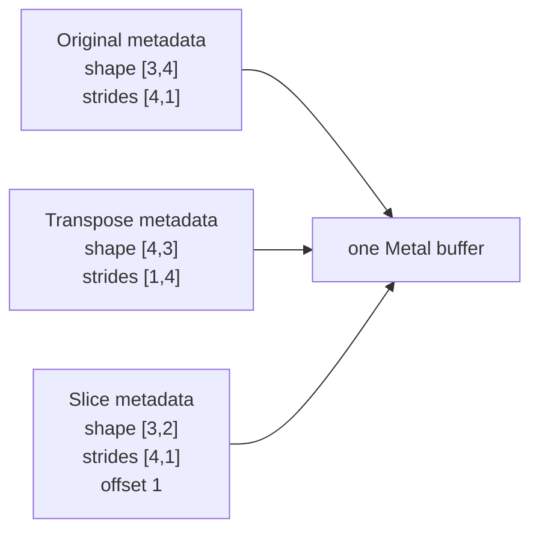

# Lesson 26 — Tensor views: transpose and slice

## The one idea

```text
view = same storage + different shape/strides/offset
```

A view does not copy tensor values and does not allocate another Metal
buffer. It gives a new logical interpretation to existing storage.

## Start with one matrix

```text
shape   = [3,4]
strides = [4,1]
offset  = 0

logical matrix:
[
  [ 0,  1,  2,  3],
  [ 4,  5,  6,  7],
  [ 8,  9, 10, 11]
]

flat storage:
[0, 1, 2, 3, 4, 5, 6, 7, 8, 9, 10, 11]
```

Every view below shares that same flat storage.



## What we built

```cpp
RuntimeTensor transpose(
    const RuntimeTensor& source,
    std::size_t first_axis,
    std::size_t second_axis
);

RuntimeTensor slice(
    const RuntimeTensor& source,
    std::size_t axis,
    std::size_t start,
    std::size_t length,
    std::size_t step = 1
);
```

Both functions return a new `RuntimeTensor` handle. Its layout is new, but its
`minigpu::Buffer` handle points to the source's Metal allocation.

## 1. Transpose

Transpose exchanges two logical axes.

```cpp
RuntimeTensor transposed =
    transpose(matrix, 0, 1);
```

We swap the two shape entries:

```text
[3,4] → [4,3]
```

We also swap the corresponding strides:

```text
[4,1] → [1,4]
```

No values move. The view reads them in a new order:

```text
[
  [0, 4,  8],
  [1, 5,  9],
  [2, 6, 10],
  [3, 7, 11]
]
```

For example:

```text
transposed[2,1]
    → offset + 2 × 1 + 1 × 4
    → storage[6]

matrix[1,2]
    → offset + 1 × 4 + 2 × 1
    → storage[6]
```

Those two logical coordinates name the same physical value.

The central code is simply:

```cpp
Shape shape = source.shape();
Strides strides = source.strides();

std::swap(shape[first_axis], shape[second_axis]);
std::swap(strides[first_axis], strides[second_axis]);
```

## 2. Slice

This lesson describes a slice using:

```text
axis, start, length, step
```

For each selected position:

```text
start + logical_coordinate × step
```

The new metadata is:

```text
new offset =
    old offset + start × old stride[axis]

new shape[axis] =
    length

new stride[axis] =
    old stride[axis] × step
```

Everything else stays unchanged.

If `length` is `1`, the step can never advance to another element. The
implementation keeps the old stride instead of calculating a meaningless
product that could overflow.

### Select two middle columns

```cpp
RuntimeTensor columns =
    slice(matrix, 1, 1, 2);
```

This selects columns `1` and `2`:

```text
[
  [1,  2],
  [5,  6],
  [9, 10]
]
```

Its layout is:

```text
shape   = [3,2]
strides = [4,1]
offset  = 1
```

The offset skips column `0`. The row stride remains `4`, because neighboring
logical rows still begin four physical slots apart.

This view is non-contiguous. After `[1,2]`, storage contains a skipped value
before the next logical row begins.

### Select every other column

```cpp
RuntimeTensor even_columns =
    slice(matrix, 1, 0, 2, 2);
```

This selects columns `0` and `2`:

```text
[
  [0,  2],
  [4,  6],
  [8, 10]
]
```

Its column stride changes:

```text
old column stride = 1
step              = 2
new column stride = 1 × 2 = 2
```

## 3. Why this is zero-copy

The helper ends with:

```cpp
return RuntimeTensor(
    new_type,
    new_layout,
    source.buffer()
);
```

`source.buffer()` is copied as a handle. Lesson 14's `Buffer` uses shared
ownership, so the actual Metal allocation is not duplicated.

```text
source RuntimeTensor ──┐
                       ├── same Metal buffer
view RuntimeTensor ────┘
```

This means:

```cpp
transposed.store({2, 1}, 60);

matrix.load({1, 2}); // 60
```

It also means a returned view keeps the allocation alive even if the source
handle goes out of scope.

### Important aliasing consequence

Lesson 25 guarantees that coordinates inside one supported layout do not
overlap each other. It does not say that two different views cannot overlap:

```text
matrix[1,2]       ─┐
                   ├── storage[6]
transposed[2,1]   ─┘
```

That sharing is the purpose of a view. It also means concurrent or in-place
writes through overlapping views need careful ordering. Shared ownership
solves lifetime; it does not solve data races or decide which write should
happen first. This lesson performs all view reads and writes sequentially.

## 4. Views can be composed

A view is still a normal `RuntimeTensor`, so another view can use it:

```cpp
RuntimeTensor transposed =
    transpose(matrix, 0, 1);

RuntimeTensor part =
    slice(transposed, 0, 1, 2);
```

The second operation starts from the transposed shape, strides, and offset.
It still reaches the original buffer.

No chain of runtime objects is needed:

```text
final view metadata → original shared buffer
```

## 5. Contiguous versus non-contiguous views

A view may or may not be contiguous.

Selecting complete rows:

```cpp
slice(matrix, 0, 1, 2);
```

produces:

```text
shape=[2,4], strides=[4,1], offset=4
```

The eight selected values are adjacent, so it is contiguous.

Selecting columns:

```cpp
slice(matrix, 1, 1, 2);
```

produces:

```text
shape=[3,2], strides=[4,1], offset=1
```

The rows contain gaps, so it is non-contiguous.

This distinction matters later because a GPU kernel must use the layout when
reading a non-contiguous tensor.

## What did not happen

Creating a view does not:

```text
allocate a new Metal buffer
copy tensor values
submit a GPU command
wait for the GPU
```

It only calculates metadata and copies a shared buffer handle.

## Safety checks

`transpose` checks that both axes exist.

`slice` checks:

```text
axis exists
length is not zero
step is greater than zero
start is inside the axis
the final selected coordinate is inside the axis
address arithmetic does not overflow
```

Lesson 26 still allows only positive strides and non-empty dimensions.

## Why inference engines need views

Views help avoid unnecessary memory movement when an inference engine needs
another interpretation of the same values:

```text
transpose a matrix
select a token range
select attention heads
select part of a KV cache
split or inspect batches
```

Avoiding copies saves memory bandwidth, allocations, and dispatches.

## What to read

Read these three parts:

1. `make_view` — new metadata plus the same buffer.
2. `transpose` — swap shape and stride entries.
3. `slice` — change offset, shape, and one stride.

Skim:

```text
overflow helpers
error tests
printing code
```

## Build and run

```bash
xcrun clang++ \
  -std=c++20 \
  -O2 \
  -Wall \
  -Wextra \
  -Wpedantic \
  -Werror \
  -Wconversion \
  -Wsign-conversion \
  -fobjc-arc \
  outputs/infer-lab/phase0/lesson21-types-shapes-broadcasting/miniir.cpp \
  outputs/infer-lab/phase0/lesson25-tensor-storage-layout/runtime_tensor.cpp \
  outputs/infer-lab/phase0/lesson26-tensor-views/tensor_views.cpp \
  outputs/infer-lab/phase0/lesson14-metal-minigpu/minigpu.mm \
  outputs/infer-lab/phase0/lesson26-tensor-views/demo.cpp \
  -framework Foundation \
  -framework Metal \
  -o work/lesson26_tensor_views

./work/lesson26_tensor_views
```

## Main takeaways

1. A view shares storage with its source.
2. Transpose swaps shape and stride entries.
3. Slice changes offset, one shape entry, and possibly one stride.
4. Writing through a view writes the shared buffer.
5. A view can outlive its source handle because `Buffer` has shared
   ownership.
6. Views can be composed without copying values.
7. Some views are non-contiguous, so future GPU kernels must understand
   strides and offsets.

## Deliberately deferred

Later lessons will add:

```text
negative strides
empty tensors
reshape rules
materializing a contiguous copy
GPU kernels that consume arbitrary layouts
```

## Next lesson

Lesson 27 will make a real Metal kernel read layout metadata:

```text
logical index
    ↓
multidimensional coordinates
    ↓
strides + offset
    ↓
physical buffer index
```
